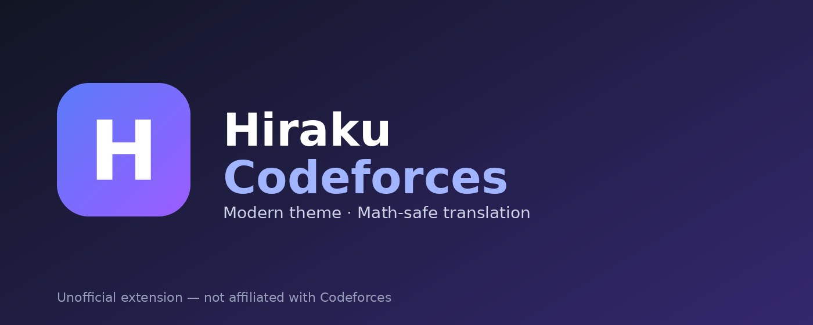

## 🇧🇷 Novidades

Esta é a maior atualização do Hiraku Codeforces até agora: chegam o **Hiraku Analytics** e o **heatmap com modos**, e vêm junto a **identidade nova**, o **college standings** e várias correções do tema escuro, que ainda não tinham chegado às lojas.

### 📊 Hiraku Analytics
Um painel dentro do próprio Codeforces, para qualquer handle. Abra pelo item **Analytics** no menu do topo, pelo link em cima do calendário do perfil ou pelo botão no popup.
- **Visão geral:** resolvidos, últimos 30 e 7 dias, sequência atual e recorde, seu *nível* (média dos últimos 50 resolvidos), o mais difícil que você já fez, taxa de aceitação, dias ativos e contests com rating.
- **Gráficos:** calendário dos últimos 12 meses, resolvidos por dificuldade (nas cores de rank) e por mês, histórico de rating sobre as faixas de rank, tags mais resolvidas, veredictos e linguagens.
- **Tentando agora:** o que você tentou nos últimos 30 dias e ainda não passou.
- **O que resolver agora:** problemas um pouco acima do seu nível que você ainda não fez, dos mais resolvidos pela comunidade para os menos, com filtro por tag.
- **Amigos e Instituição:** todo mundo lado a lado, com rating, resolvidos, últimos 7 e 30 dias, nível, o mais difícil do mês, sequência, o que cada um está tentando agora e o último envio. A coluna **vs você** mostra quem está fazendo mais ou menos problemas e em nível mais alto ou mais baixo. Também tem um ranking dos últimos 30 dias, e as colunas são ordenáveis.

### 🟩 Heatmap com modos
Os quadradinhos verdes do perfil agora podem mostrar **problemas resolvidos**, **envios**, **o problema mais difícil do dia** ou **a dificuldade média do dia** (nas cores de rank). Vem com legenda e com tooltip por dia. A escala se ajusta ao seu dia mais puxado, como no GitHub.

### 🎨 Identidade nova (desde a 0.4.0)
Logo, ícones e popup na família Hiraku: o livro aberto da marca antiga, agora com o gradiente rosa → lilás → roxo e a centelha 開 entre as páginas. O tema escuro ficou roxo e o destaque padrão é rosa.

### 🏫 College standings e qualidade de vida (desde a 0.4.0)
- **College standings:** em qualquer standings, busque por handle ou equipe, ou veja só a **sua instituição**, com a posição dentro dela e a geral.
- **Anti-spoiler:** tags e dificuldade ficam borradas até você passar o mouse.
- **Esconder problemas resolvidos** na lista de problemas.

### 🛠️ Correções
- A logo do Codeforces no tema escuro não fica mais com o miolo das letras branco nem com contorno cinza.
- Nos exemplos com vários testes, a linha destacada ao passar o mouse ficava creme com texto claro, ilegível. Agora usa a cor de destaque.
- Campos com foco, preenchimento automático e placeholder ficaram legíveis no tema escuro.

### 🔒 Privacidade
Tudo vem do próprio Codeforces: da API pública (chamadas anônimas, uma a cada 2 s, como o Codeforces pede) e da sua página `/friends`. Os resumos ficam guardados no seu navegador por 30 minutos. Nada é enviado para outro lugar. Detalhes na [política de privacidade](https://github.com/IcaropLira/BetterCodeforces/blob/main/PRIVACY.pt-BR.md).

---

## 🇺🇸 What's new

The biggest Hiraku Codeforces update so far: **Hiraku Analytics** and a **heatmap with modes**, together with the **new identity**, **college standings** and the dark-theme fixes that had not reached the stores yet.

- **📊 Hiraku Analytics** (top menu → *Analytics*, the profile, or the popup), for any handle: your numbers and charts (difficulty, months, rating, tags, verdicts, languages, streaks), what you are *trying now*, *what to solve next* just above your level, and **Friends** / **Institution** side by side with a *vs you* column, a 30-day ranking and sortable columns.
- **🟩 Heatmap with modes:** color the profile squares by problems solved, submissions, or the hardest / average difficulty of each day, with a legend and per-day tooltips.
- **🎨 New identity** in the Hiraku family, a plum dark theme and a pink accent.
- **🏫 College standings,** anti-spoiler tags and *hide solved problems*.
- **🛠️ Fixes:** the Codeforces logo in dark mode, unreadable highlighted sample lines, and input fields in the dark theme.
- **🔒 Privacy:** everything comes from Codeforces itself (public API, anonymous, one call every 2 s, plus your own `/friends` page). Nothing is sent anywhere else.

**Install:** [Chrome Web Store](https://chromewebstore.google.com/detail/hiraku-codeforces/kbjfgloamahakmngfecokkmffeakjnpk) · [Firefox Add-ons](https://addons.mozilla.org/firefox/addon/hiraku-for-codeforces/) · or the `.zip` files below.
