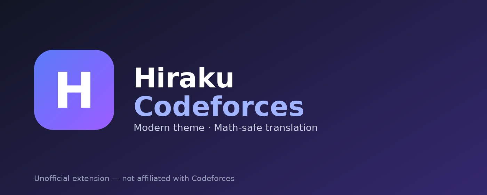

## 🇧🇷 Novidades

A maior atualização do Hiraku Codeforces até agora. O Codeforces deixa de ser só um lugar para resolver problemas e passa a mostrar como você está evoluindo, e como estão seus amigos e sua instituição. Esta versão reúne tudo o que foi feito desde a 0.3: as versões 0.4, 0.5 e 0.6 chegam às lojas juntas.

### 👥 Quem você conhece, em cada problema
Ao abrir um problema, uma caixa no topo da sidebar mostra:
- se **você** já resolveu (e quando) ou só tentou;
- quais **amigos** e **colegas de instituição** já resolveram, com a data, e quem tentou e ainda não passou.

Na primeira vez a extensão aprende o que cada pessoa resolveu (em segundo plano, começando por você e pelos amigos). Depois disso, abrir qualquer problema é instantâneo. Dá para desligar a caixa ou tirar a instituição no popup.

### 📊 Hiraku Analytics
Um painel dentro do próprio Codeforces, para qualquer handle. Abra pelo item **Analytics** no menu do topo, pelo link no perfil ou pelo popup.
- **Números:** resolvidos; últimos 7, 30, 90 e 365 dias; **média de problemas por dia**; sequência atual e recorde; seu *nível* (média dos últimos 50 resolvidos); o mais difícil que você já fez; **taxa de acerto de primeira**; envios por resolvido; aceitação; dias ativos; contests.
- **Gráficos:** calendário de 12 meses, resolvidos por dificuldade e por mês, **nível mês a mês**, **total acumulado**, rating sobre as faixas de rank, **resolvidos por dia da semana**, **envios por hora do dia**, ritmo, tags, veredictos e linguagens.
- **Tags fortes e fracas:** em quais assuntos você resolve quase tudo o que tenta, e quais precisam de treino.
- **Contests:** melhor colocação, maior ganho, maior queda, variação média e saldo dos últimos 5.
- **Upsolve:** o que você tentou num contest e nunca resolveu.
- **Tentando agora** e **o que resolver agora:** problemas um pouco acima do seu nível, com filtro por tag.
- **Amigos e Instituição:** todo mundo lado a lado, com rating, resolvidos, 7 e 30 dias, média por dia, nível, o mais difícil do mês, sequência, o que cada um está tentando e o último envio. A coluna **vs você** compara cada um com você, e há um **resumo do grupo** (ativos na semana, total do mês, média por pessoa, nível médio, quem está mais ativo, maior sequência) e um ranking dos últimos 30 dias.

### 📤 Exportar
- **Uma pessoa:** os problemas resolvidos em **CSV** (data, problema, rating, envios até o AC, tags, link) ou tudo o que aparece no painel em **JSON**.
- **Uma instituição ou os seus amigos:** a tabela inteira em **CSV** ou **JSON**, pronta para planilha, relatório de treino ou acompanhamento da turma.

O CSV abre certo no Excel e no Google Sheets, com acentos.

### 🟩 Heatmap com modos
Os quadradinhos verdes do perfil podem mostrar **problemas resolvidos**, **envios**, **o problema mais difícil do dia** ou **a dificuldade média do dia** (nas cores de rank), com legenda e tooltip por dia.

### 🏫 College standings e qualidade de vida
- **College standings:** em qualquer standings, busque por handle ou equipe, ou veja só a **sua instituição**, com a posição dentro dela e a geral.
- **Anti-spoiler:** tags e dificuldade ficam borradas até você passar o mouse.
- **Esconder problemas resolvidos** na lista de problemas.

### 🎨 Identidade nova
Logo, ícones e popup na família Hiraku: o livro aberto da marca antiga, agora com o gradiente rosa → lilás → roxo e a centelha 開. O tema escuro ficou roxo e o destaque padrão é rosa.

### 🛠️ Correções
- A logo do Codeforces no tema escuro não fica mais com o miolo das letras branco nem com contorno cinza.
- A linha destacada nos exemplos com vários testes ficou legível.
- Campos com foco, preenchimento automático e placeholder ficaram legíveis no tema escuro.

### 🔒 Privacidade
Tudo vem do próprio Codeforces: da API pública (chamadas anônimas, uma a cada 2 s, como o Codeforces pede) e da sua página `/friends`. O que é guardado fica no seu navegador, e as exportações são geradas e salvas direto no seu computador. Nada é enviado para outro lugar. Detalhes na [política de privacidade](https://github.com/IcaropLira/BetterCodeforces/blob/main/PRIVACY.pt-BR.md).

---

## 🇺🇸 What's new

The biggest Hiraku Codeforces update so far. It brings everything since 0.3 to the stores: 0.4, 0.5 and 0.6 together.

- **👥 People you know, on every problem:** a sidebar box shows whether you solved or tried it, and which friends and institution members solved it (with the date) or tried it. After the first load, every problem opens instantly.
- **📊 Hiraku Analytics** (top menu → *Analytics*), for any handle:
  - numbers such as problems per day, first-try rate and the last 7/30/90/365 days;
  - charts for level per month, total over time, weekday, hour of day, difficulty, rating, tags, verdicts and languages;
  - strong and weak tags, contest stats and an upsolve list;
  - what you are trying now and what to solve next;
  - **Friends / Institution** side by side, with a *vs you* column, a group summary and a 30-day ranking.
- **📤 Export** a person's solved problems (CSV) or full analytics (JSON), and a whole group comparison (CSV / JSON).
- **🟩 Heatmap with modes:** color the profile squares by problems solved, submissions, or the hardest / average difficulty of each day.
- **🏫 College standings,** anti-spoiler tags and *hide solved problems*.
- **🎨 New identity** in the Hiraku family, plus dark-theme fixes (Codeforces logo, highlighted sample lines, input fields).
- **🔒 Privacy:** everything comes from Codeforces itself (public API, anonymous, one call every 2 s, plus your own `/friends` page). Data stays in your browser, and exports are generated locally.

**Install:** [Chrome Web Store](https://chromewebstore.google.com/detail/hiraku-codeforces/kbjfgloamahakmngfecokkmffeakjnpk) · [Firefox Add-ons](https://addons.mozilla.org/firefox/addon/hiraku-for-codeforces/) · or the `.zip` files below.
